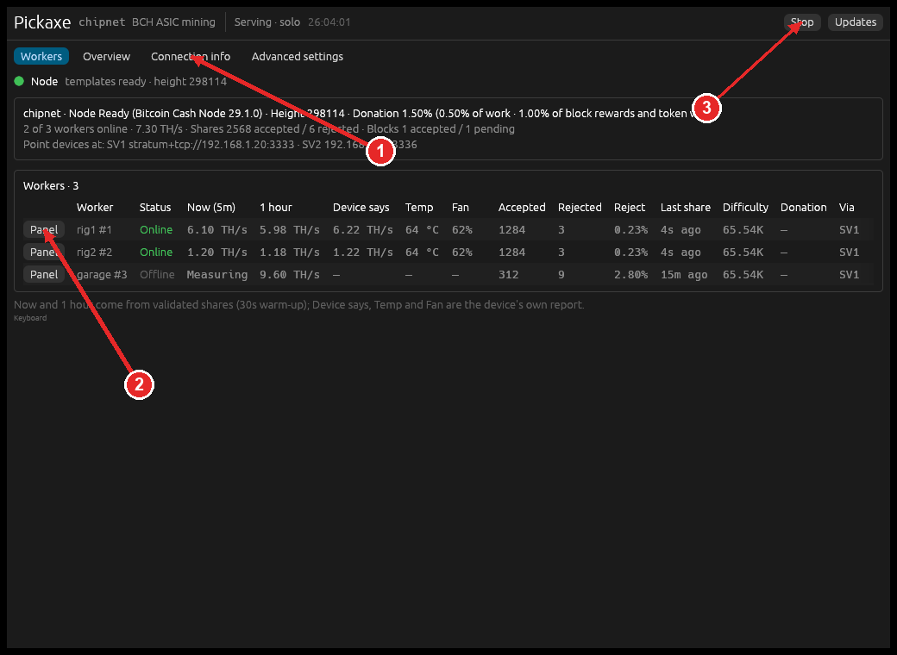
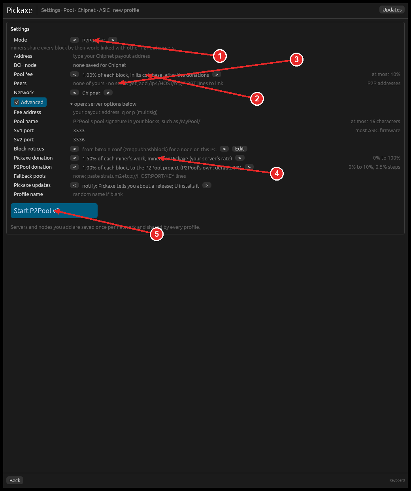
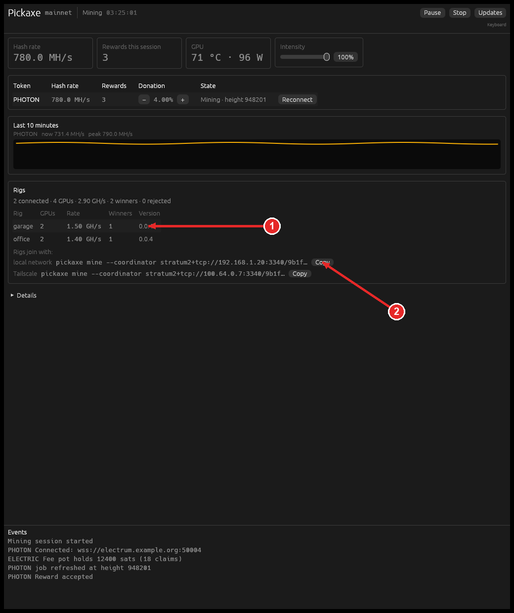
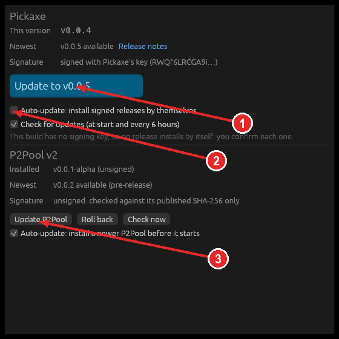

# Guide: mining with the Pickaxe window

A step-by-step walk through the desktop window, from download to mining. The
screenshots show example data; the red numbers match the steps under each one.
The terminal (`pickaxe`) has the same setup and the same steps.

## Start here: pick what fits you

| You want to… | Use | Go to |
|---|---|---|
| Mine GPU tokens on your desktop computer | the window (`pickaxe-gui`) | steps 1–5 |
| Mine on a rig with no screen, or over SSH | the terminal (`pickaxe`) | [Terminal](#the-terminal-tui), then steps 2–5 (same setup) |
| Mine PHOTON in a web browser, nothing to install | the browser miner | [Browser](#the-browser-miner) |
| Point your BCH ASICs at your own node | the ASIC server | step 6 |
| Point your ASICs at someone else's pool | Join a pool | [Joining a pool](#joining-a-pool-with-your-asics) |
| Run a pool other people mine on | Running a pool | step 7 |
| Run several GPU rigs as one farm | a coordinator and rigs | step 8 |
| Use HiveOS, mmpOS or RaveOS | the mining OS packages | [Mining OS](#mining-os-hiveos-mmpos-raveos) |
| Run it in Docker | the container image | [Docker](#docker) |
| Use your own BCHN or Knuth node | the BCH node row in step 4 | [Your own node](#your-own-node) |
| Try everything without real money first | Chipnet | [Chipnet](#chipnet-try-it-first) |

## 1. Download and start

1. Download your system's archive from the
   [latest release](https://github.com/CyberAshven/pickaxe-miner/releases/latest)
   (Windows `.zip`, Linux `.tar.gz` or `.deb`, macOS `.tar.gz`) and unpack it.
2. Double-click **`pickaxe-gui`** (`pickaxe-gui.exe` on Windows). The window
   opens on your mining profiles. On Debian or Ubuntu, after
   `sudo apt install ./pickaxe-miner_*.deb`, run `pickaxe-gui`.

`pickaxe` (without `-gui`) is the same program in the terminal, for rigs
without a desktop.

## 2. Profiles


1. **+ New profile** starts the setup: hardware (GPU mining, ASIC mining or
   running a pool), network (Mainnet or Chipnet), then the token or mode.
2. **Open** a saved profile to go straight to its settings, with Start ready.
   **Rename** and **Delete** are beside it.
3. **Updates** shows whether a newer Pickaxe or P2Pool is out (see step 9).

## 3. Choose what to mine

Pickaxe mines two kinds of things.

**GPU tokens**: CashTokens your GPUs mine. The token step lists them:


1. **PHOTON**: a GPU token whose rewards come straight from mining; nothing to
   fund.
2. **ELECTRIC**: a GPU token that uses a **fee pot**: you fund the pot with
   plain BCH, and it pays each claim's fee ([fee pot](#electrics-fee-pot)).
3. **Hash split**: two GPU tokens at once, each with a share of the GPUs that
   you set on the dashboard ([hash split](hash-split.md)).

**ASIC mining**: choose **ASIC mining** in step 2 instead.

- **BCH**: your ASICs mine Bitcoin Cash through Pickaxe's Stratum server,
  solo on your own node (step 6) or at a pool
  ([joining a pool](#joining-a-pool-with-your-asics)).
- **ASIC tokens** such as **SAFA**: tokens only ASICs can mine, mined by
  **merge mining**, in the same work as BCH, so an ASIC earns BCH and the
  tokens at once. Upcoming: their production list stays empty until the
  contracts are deployed; tSAFA tests it on Chipnet
  ([merge mining](merge-mining.md), [ASIC tokens](asic-tokens.md)).

Running a pool for others is step 7.

## 4. Settings and Start


1. **Address**: your Bitcoin Cash address, where rewards are paid. Click the row
   to type it.
2. **Advanced** opens the extra rows: a rig port for other computers, the
   donation, Pickaxe updates and the profile's name.
3. **Start mining** checks the settings, saves the profile and starts.

Each row's **<** **>** buttons change its value. The GPU, Fulcrum and BCH node
rows open their lists, where a node or Fulcrum server on this or another
computer is added with a click. See
[what Pickaxe needs from a node](node-requirements.md) for BCHN and Knuth.

## 5. The mining dashboard

This one is a **hash split** session (PHOTON and ELECTRIC). With one token the
share column is not shown, and the fee pot shows only for ELECTRIC.


1. **Pause** stops the GPUs and keeps the session; **Stop** ends it.
2. **Intensity** sets how hard the GPUs work.
3. In a hash split, each token's **share** of the GPUs: **−** and **+**.
4. ELECTRIC's **fee pot**: send plain BCH to this address (scan the QR code) to
   pay its claims' fees. PHOTON needs no fee pot.

The graphs show the last 10 minutes; **Details** opens more; the events log is
at the bottom.

## 6. BCH ASICs: the Stratum server

Choose **ASIC mining** in step 2, then **Solo** on your own node, or **Join a
pool**. Pickaxe is the Stratum V1 and V2 server your ASICs connect to; it does
not hash BCH itself.



1. **Connection info** lists the addresses to type into your ASICs (SV1 and
   SV2), with a button to copy each.
2. **Panel** opens one device: its pools, frequency and fan where the firmware
   allows.
3. **Stop** stops the server.

## 7. Run a pool for other miners

Choose **Running a pool** in step 2. The settings then start with its **Mode**:



1. **Mode**, with **<** **>**:
   - **Public Solo Endpoint**: each miner mines solo, and whoever finds a block
     takes it.
   - **Non-custodial Pool**: miners share every block by their work, paid
     straight from the block, through your own P2Pool that stays separate.
   - **P2Pool v2**: the same, linked with other P2Pool servers.
2. **Pool fee**: your operator fee, taken in the block's coinbase.
3. **Peers**: other P2Pool servers to link with (P2Pool v2).
4. Under **Advanced**: the **Pickaxe donation** and **P2Pool donation**, the
   SV1 and SV2 ports, block notices and fallback pools.
5. **Start** starts the node connection, P2Pool and the server. Miners then
   connect as in step 6.

More: [pool modes](pool.md), [P2Pool](p2pool.md).

## 8. A GPU farm of several rigs

Turn on **Rig port** under **Advanced** in step 4 on the computer that leads (the
coordinator). Its dashboard then lists the rigs:



1. Each connected rig, with its GPUs, rate and winners.
2. **Copy** the command a rig runs to join, on the local network or over
   Tailscale; every rig mines with all its GPUs, and the coordinator claims.

## 9. Updates



1. **Update** downloads the new Pickaxe; it is put in place when you restart
   between sessions. Every download is checked against the release's
   published SHA-256 before anything is unpacked.
2. **Auto-update** installs new releases by themselves, once releases are
   signed with Pickaxe's key; until then each update asks you first.
3. **Update P2Pool** (with **Roll back**) does the same for P2Pool v2.

## Joining a pool with your ASICs

Choose **ASIC mining** and **Join a pool**, then enter the pool's address,
`stratum2+tcp://HOST:PORT/KEY` (its key is the pool's authority key, which
pins it). Pickaxe connects to the pool, and your ASICs connect to Pickaxe over
SV1 or SV2, so firmware that only speaks SV1 still mines at an SV2 pool.

With your own node you can also choose **your templates** (Job Declaration):
at a pool that accepts it, your node picks the block's transactions
(Full-Template, or Coinbase only), and the devices fall back to the pool's own
jobs if the node stops. **Fallback pools** under Advanced take over while the
first is unreachable ([ASIC mining](stratum-v2.md)).

## ELECTRIC's fee pot

- **Fund it**: its address and QR code show beside the settings and on the
  dashboard (`F` in the terminal). Send plain BCH; each claim takes its
  network fee, and the BCH that travels with the reward tokens, from the pot.
- **Watch it**: the dashboard shows its balance and about how many claims it
  pays for.
- **Take it back**: `pickaxe --address YOUR_ADDRESS electric refund` prints
  the transactions that return every pot coin to your address; add
  `--broadcast` to send them.

Pickaxe keeps the pot's key beside your settings: back that folder up, and
keep it private ([ELECTRIC](electric-token.md)).

## Donations and fees

- **GPU tokens**: a share of the mining work goes to the Pickaxe project, 4%
  by default for PHOTON and ELECTRIC. Change it under **Advanced**, down to
  0%, in 0.5% steps.
- **ASICs** (BCH and merge-mined tokens): one setting, 1.5% by default
  (0.5% of the work, and 1% of block rewards and token wins), from 0% under
  **Advanced**.
- **Pools**: your **pool fee** as an operator is separate, and so is
  **P2Pool's donation** to the P2Pool project (1% by default). At a pool run
  with Pickaxe, the higher of the pool's and the miner's Pickaxe donation
  applies, once.
- Network fees are separate from all of these
  ([fee policy](fee-policy.md), [pool modes](pool.md)).

## Troubleshooting

- **No GPU in the list**: install your GPU's driver (NVIDIA's for CUDA;
  Vulkan or OpenCL drivers for AMD and Intel). `pickaxe devices` lists what
  Pickaxe sees.
- **The node is not used**: the **BCH node** row says why (not synced, wrong
  network, needs its login). Until it is ready, GPU tokens keep mining through
  Fulcrum servers.
- **ASICs do not connect**: use the addresses under **Connection info**, and
  open the SV1 and SV2 ports (3333 and 3336 by default) in the firewall; on
  another network, use Tailscale.
- **Stopping while claims are pending**: let them settle before closing
  Pickaxe; the terminal's `B` returns to the profiles only once they have.
- **A diagnostic log**: set `PICKAXE_TUI_LOG` to a file path before starting
  ([diagnostic logging](../README.md#diagnostic-logging)).

## Other ways to run Pickaxe

### The terminal (TUI)

Run `pickaxe` (`.\pickaxe.exe` in PowerShell) from the unpacked download, or
double-click it. It opens the same setup as the window: profiles, hardware,
network, token, settings and **Start mining**, with the arrow keys, Enter and
Esc. On the mining dashboard, `G` shows charts, `A` opens Advanced settings,
`F` opens ELECTRIC's fee pot and `B` goes back to the profiles once pending
claims are settled. To start PHOTON straight away:

```sh
pickaxe mine --address "bitcoincash:YOUR_ADDRESS"
```

Add `--no-tui` for a plain log with no screen, as a service would run it
([farms and services](farm.md#running-rigs-as-a-service)).

### The browser miner

PHOTON only, in a browser with WebGPU. Unpack the `browser` download, run
`python -m http.server 8080 --bind 127.0.0.1 --directory web` in it, open
`http://127.0.0.1:8080`, choose Mainnet or Chipnet, enter your address and
press **Start mining**. Keep the tab open, and pause native GPU mining while it
runs ([browser miner](../README.md#browser-miner)).

### Mining OS (HiveOS, mmpOS, RaveOS)

Install the release's `pickaxe-hiveos`, `pickaxe-mmpos` or `pickaxe-raveos`
package as a custom miner. The flight sheet's pool, wallet and password
fields become Pickaxe's options: solo PHOTON, or a rig joining your
coordinator. What to put in each field: [farm OS packages](farm-os.md) and
[farms](farm.md#farm-operating-systems-hiveos-mmpos-raveos).

### Docker

The headless image runs `pickaxe mine --no-tui` and keeps its settings in a
volume:

```sh
docker run --rm -it --gpus all -v pickaxe-data:/data \
  ghcr.io/cyberashven/pickaxe-miner:latest \
  --config /data/pickaxe.json mine --no-tui --address 'bitcoincash:YOUR_ADDRESS'
```

NVIDIA needs the host driver and the NVIDIA Container Toolkit; AMD and Intel
need their device files passed in ([container guide](container.md)).

### Your own node

Pickaxe works with servers on the internet by default. To use your own node,
add it in step 4's **BCH node** row: one on this computer is found by itself,
one on another computer is added with **Other PC** or **Tailscale**, and a
Fulcrum server the same way in the **Fulcrum** row. BCHN and Knuth both work;
what each one supports is in [what Pickaxe needs from a node](node-requirements.md).

### Chipnet: try it first

Choose **Chipnet** in the network step to try any of the above with test
coins that have no value: GPU tokens, ASICs, pools and farms all run there the
same way ([Mainnet and Chipnet](../README.md#mainnet-and-chipnet)).

More detail: [desktop window](desktop-window.md),
[updates](updates.md), [ASIC mining](stratum-v2.md), [P2Pool](p2pool.md),
[GPU farms](farm.md),
[all guides](README.md).
