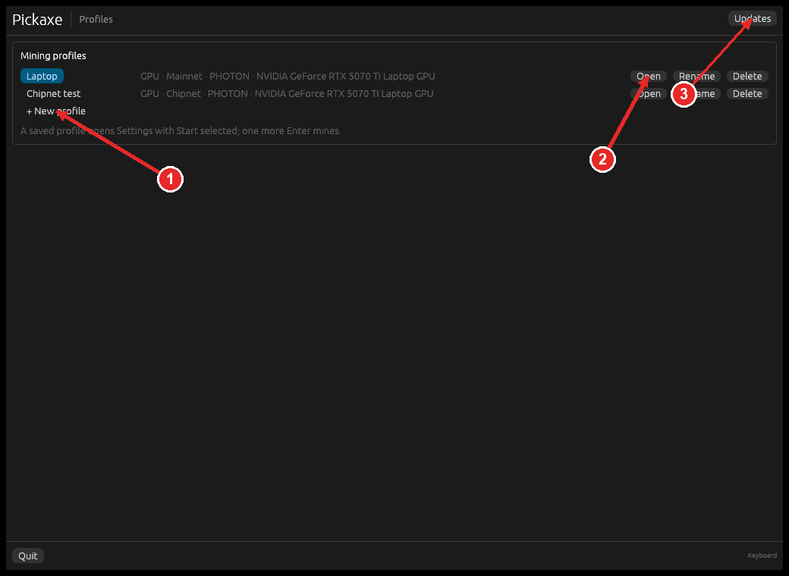
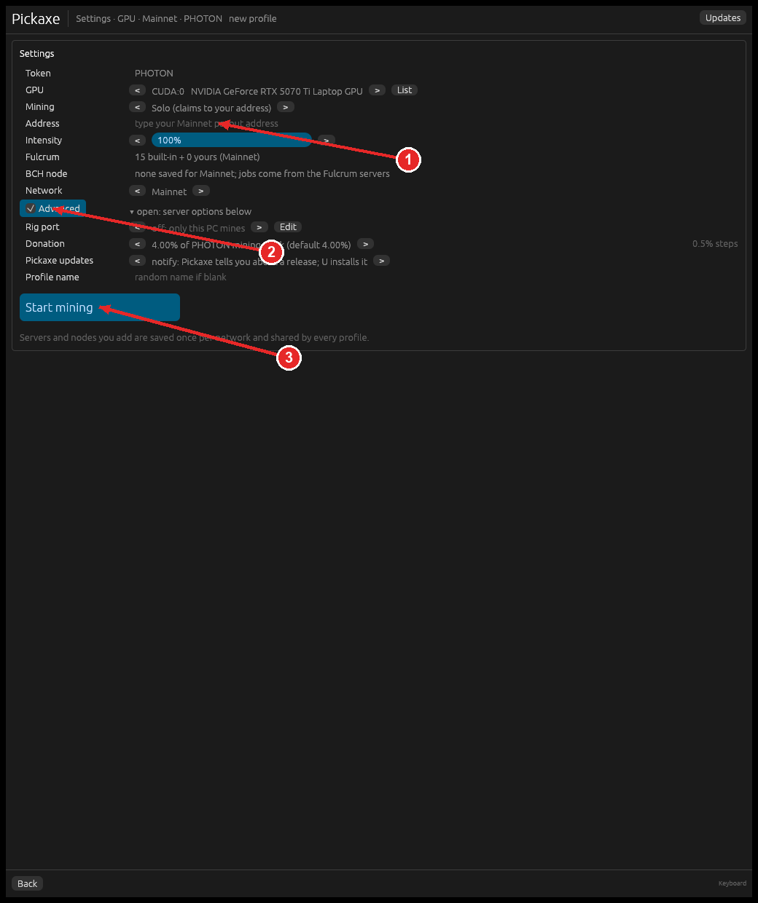

# Guide: mining with the Pickaxe window

A step-by-step walk through the desktop window, from download to mining. The
screenshots show example data; the red numbers match the steps under each one.
The terminal (`pickaxe`) has the same setup and the same steps.

## 1. Download and start

1. Download your system's archive from the
   [latest release](https://github.com/CyberAshven/pickaxe-miner/releases/latest)
   (Windows `.zip`, Linux `.tar.gz` or `.deb`, macOS `.tar.gz`) and unpack it.
2. Double-click **`pickaxe-gui`** (`pickaxe-gui.exe` on Windows). The window
   opens on your mining profiles. On Debian or Ubuntu, after
   `sudo apt install ./pickaxe-miner_*.deb`, run `pickaxe-gui`.

`pickaxe` (without `-gui`) is the same program in the terminal, for rigs
without a desktop.

## 2. Profiles

1. **+ New profile** starts the setup: hardware (GPU mining, ASIC mining or
   running a pool), network (Mainnet or Chipnet), then the token or mode.
2. **Open** a saved profile to go straight to its settings, with Start ready.
   **Rename** and **Delete** are beside it.
3. **Updates** shows whether a newer Pickaxe or P2Pool is out (see step 6).

## 3. Settings and Start

1. **Address**: your Bitcoin Cash address, where rewards are paid. Click the row
   to type it.
2. **Advanced** opens the extra rows: a rig port for other computers, the
   donation, Pickaxe updates and the profile's name.
3. **Start mining** checks the settings, saves the profile and starts.

Each row's **<** **>** buttons change its value. The GPU, Fulcrum and BCH node
rows open their lists, where a node or Fulcrum server on this or another
computer is added with a click. See
[what Pickaxe needs from a node](node-requirements.md) for BCHN and Knuth.

## 4. The mining dashboard

1. **Pause** stops the GPUs and keeps the session; **Stop** ends it.
2. **Intensity** sets how hard the GPUs work.
3. With two tokens, each token's **share** of the GPUs: **−** and **+**.
4. ELECTRIC's **fee pot**: send plain BCH to this address (scan the QR code) to
   pay its claims' fees. PHOTON needs no fee pot.

The graphs show the last 10 minutes; **Details** opens more; the events log is
at the bottom.

## 5. BCH ASICs: the Stratum server

Choose **ASIC mining** in step 2, then **Solo** on your own node, or **Join a
pool**; choose **Running a pool** for a Public Solo Endpoint, a Non-custodial
Pool or P2Pool v2 ([pool modes](pool.md)).

1. **Connection info** lists the addresses to type into your ASICs (SV1 and
   SV2), with a button to copy each.
2. **Panel** opens one device: its pools, frequency and fan where the firmware
   allows.
3. **Stop** stops the server.

## 6. Updates

1. **Update** downloads the new Pickaxe; it is put in place when you restart
   between sessions. Every download is checked against the release's
   published SHA-256 before anything is unpacked.
2. **Auto-update** installs new releases by themselves, once releases are
   signed with Pickaxe's key; until then each update asks you first.
3. **Update P2Pool** (with **Roll back**) does the same for P2Pool v2.

More detail: [desktop window](desktop-window.md),
[updates](updates.md), [ASIC mining](stratum-v2.md), [P2Pool](p2pool.md),
[all guides](README.md).
